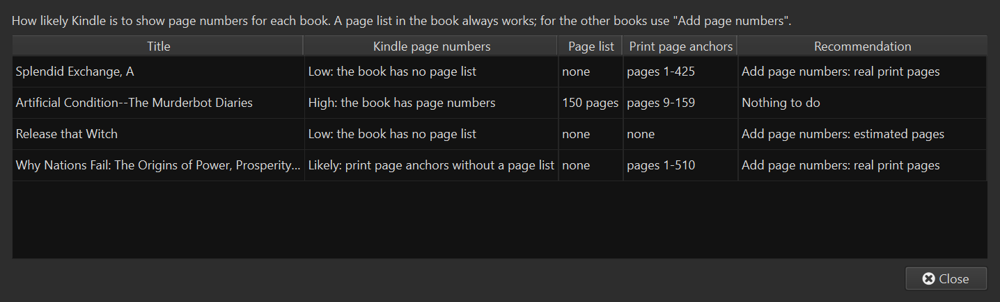
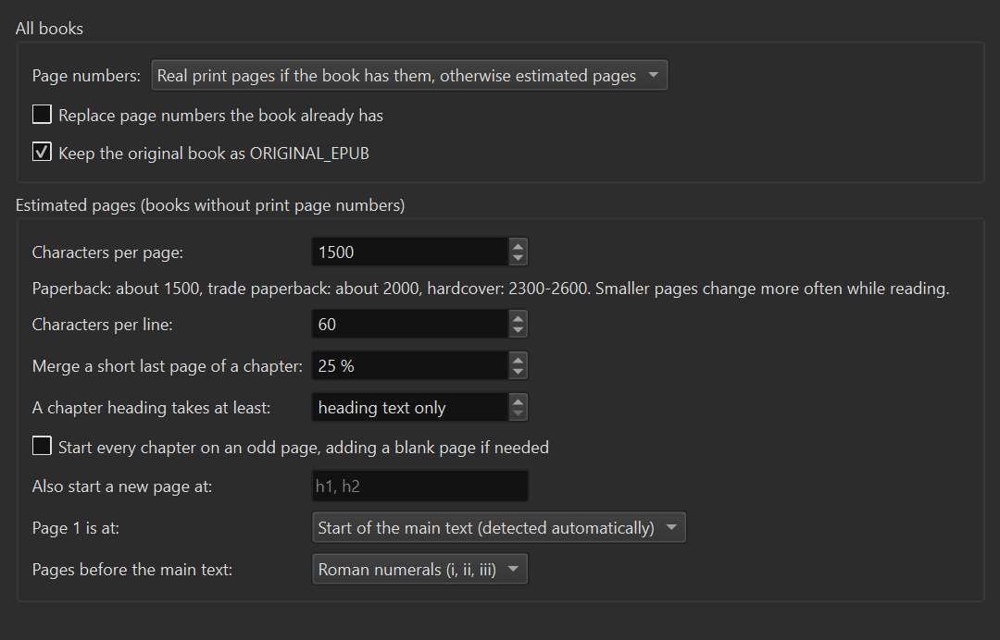

# Owl EPUB Pages

*[Русская версия](README.ru.md)*

A [calibre](https://calibre-ebook.com) plugin that adds page numbers to EPUB books, so
that Kindle (via Send to Kindle) and other readers show **pages** instead of only
locations or percent.



## Why

A reader shows real page numbers only when the EPUB contains a *page list*: a
`<nav epub:type="page-list">` in the EPUB 3 navigation document or a `<pageList>` in the
NCX. Many EPUBs don't have one, even when the publisher left print-page anchors
inside the text. The plugin builds the page list:

- **Real print pages.** If the book contains print-page anchors
  (`epub:type="pagebreak"`, `role="doc-pagebreak"` or ids like `page12`, `lpn_12`),
  the page list is built from them. Page numbers then match the printed book and its
  index.
- **Estimated pages.** Otherwise pages are estimated the way a typesetter would lay
  them out:
  - every chapter file and every CSS page break (`page-break-before/after`) starts a
    new page;
  - a page holds a set number of characters;
  - the end of a paragraph fills the rest of its line.

  Optionally, every chapter starts on an odd page, and a short last page of a chapter
  is merged into the previous one.

Measured on books that have real print pages, the estimate stays within 1–2 pages of
the printed numbering once the page size is right.

## Installation

1. Download `OwlEpubPages-<version>.zip` from the releases (or build it, see below).
2. In calibre: **Preferences → Plugins → Load plugin from file**, choose the zip,
   restart calibre.
3. If the **Page numbers** button doesn't appear: **Preferences → Toolbars & menus**,
   add *Owl EPUB Pages* to the main toolbar.

Requires calibre 6 or later.

## Usage

Select books in the library and use the **Page numbers** button or its menu:

| Command | What it does |
|---|---|
| **Add page numbers** | Adds a page list to the EPUB of each selected book. Books that already have one are skipped unless *Replace page numbers* is set. |
| **Check page numbers** | Shows how likely Kindle is to show pages for each book and what can be done, without changing anything. |
| **Restore the original EPUB** | Puts back the EPUB saved as `ORIGINAL_EPUB` before page numbers were added. |
| **Settings** | Page size and the other options below. |

The unchanged book is kept as the `ORIGINAL_EPUB` format (only once, so repeated runs
never overwrite the true original). Then send the book to your Kindle as usual.

What the check results mean:

| Result | Meaning |
|---|---|
| **High** | The book has a page list; Kindle shows these pages. |
| **Likely** | No page list, but print-page anchors like `page12`. Kindle has shown pages for such books, but this is not guaranteed. Adding a page list makes it reliable. |
| **Low** | No page list. Add page numbers: real print pages if the book has anchors, otherwise estimated pages. |

## Settings



| Setting | Meaning |
|---|---|
| Page numbers | Real print pages if present, otherwise estimated (default); only real pages; or always estimated. |
| Characters per page | Size of an estimated page, spaces included. Paperback ≈ 1500, trade paperback ≈ 2000, hardcover ≈ 2300–2600. Smaller pages turn more often on Kindle. |
| Characters per line | Paragraph ends are rounded up to whole lines (default 60); 0 counts plain characters. |
| Merge a short last page of a chapter | If a chapter's last page would be filled less than this, it is squeezed onto the previous page. On Kindle, fewer page numbers are skipped at chapter ends. |
| A chapter heading takes at least | Share of a page taken by a heading that opens a page, with the space around it, so the first page of a chapter holds less text. Printed books use about 20–30 %; on a Kindle screen a large heading takes about a third. |
| Start every chapter on an odd page | Adds a blank page number where a printed book would have a blank left page. |
| Also start a new page at | Extra HTML tags that start a new page, e.g. `h1, h2`. |
| Page 1 is at | The start of the main text, found from the book's landmarks or guide, or from the first "Chapter 1" / "Prologue"; or the start of the book. |
| Pages before the main text | Roman numerals (i, ii, iii), no numbers, or normal numbering. |

## Command line

`plugin/core.py` uses only the Python standard library and works without calibre:

```bash
python plugin/core.py book.epub                        # writes "book (pages).epub"
python plugin/core.py --check *.epub                   # how likely Kindle shows pages
python plugin/core.py book.epub --chars-per-page 1500 --min-last-page 0.25 --chapter-sink 0.3 --body-start auto
python plugin/core.py printed.epub --compare --fit     # calibrate on a book with real pages
```

`python plugin/core.py --help` lists all options.

## Development

```bash
python build.py                           # build dist/OwlEpubPages-<version>.zip
python -m unittest discover -s tests      # unit tests of the page engine
```

`tests/calibre_smoke.py` runs the plugin's actions inside calibre on real books, with a
temporary library and a throwaway calibre configuration; see the instructions at the
top of the file.

### Translations

The interface follows calibre's language. Translations live in
`plugin/translations/<language>.po`; `build.py` compiles them into the zip, no gettext
tools needed. To add a language:

1. `python build.py --pot` writes the template `plugin/translations/messages.pot`.
2. Copy it to `plugin/translations/<language>.po` (for example `de.po`), fill in the
   `msgstr` lines and the `Plural-Forms` header.
3. `python build.py` reports missing strings and builds the zip.

## License

GPL v3, like calibre itself. See [LICENSE](LICENSE).
