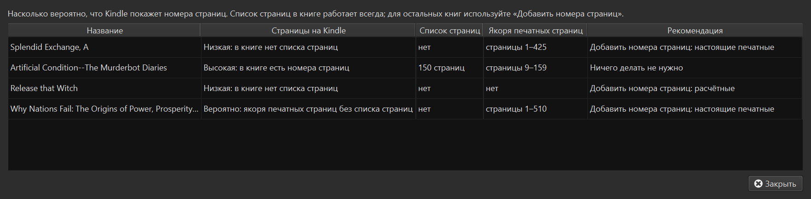
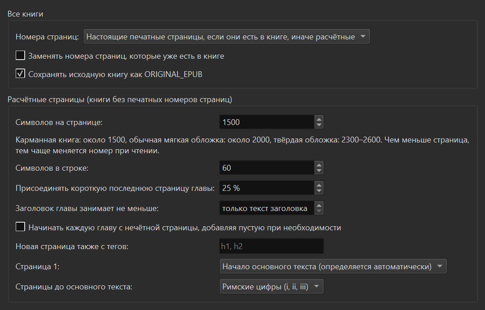

# Owl EPUB Pages

*[English version](README.md)*

Плагин для [calibre](https://calibre-ebook.com), который добавляет в книги EPUB номера
страниц. После этого Kindle (через Send to Kindle) и другие читалки показывают
**страницы**, а не только Location или проценты.



## Зачем

Читалка показывает настоящие номера страниц, только если в EPUB есть *список страниц*
(page list): `<nav epub:type="page-list">` в навигационном документе EPUB 3 или
`<pageList>` в NCX. Во многих книгах его нет, даже если издатель оставил в тексте якоря
печатных страниц. Плагин строит такой список:

- **Настоящие печатные страницы.** Если в книге есть якоря печатных страниц
  (`epub:type="pagebreak"`, `role="doc-pagebreak"` или id вида `page12`, `lpn_12`),
  список строится по ним. Номера совпадают с бумажной книгой и её указателем.
- **Расчётные страницы.** Если якорей нет, страницы рассчитываются так, как их сверстал
  бы верстальщик:
  - каждый файл главы и каждый разрыв страницы в CSS (`page-break-before/after`)
    начинают новую страницу;
  - на странице помещается заданное число символов;
  - конец абзаца занимает строку до конца.

  По желанию каждая глава начинается с нечётной страницы, а короткая последняя
  страница главы присоединяется к предыдущей.

На книгах с настоящими печатными страницами расчёт при правильном размере страницы
расходится с бумажной нумерацией на 1–2 страницы.

## Установка

1. Скачайте `OwlEpubPages-<версия>.zip` из релизов (или соберите сами, см. ниже).
2. В calibre: **Параметры → Плагины → Загрузить плагин из файла**, выберите zip и
   перезапустите calibre.
3. Если кнопка **Номера страниц** не появилась: **Параметры → Панели инструментов и
   меню**, добавьте *Owl EPUB Pages* на «Главную панель инструментов».

Нужен calibre 6 или новее.

## Использование

Выберите книги в библиотеке и нажмите кнопку **Номера страниц** или откройте её меню:

| Команда | Что делает |
|---|---|
| **Добавить номера страниц** | Добавляет список страниц в EPUB каждой выбранной книги. Книги, где он уже есть, пропускаются, если не включено «Заменять номера страниц». |
| **Проверить номера страниц** | Показывает, насколько вероятно, что Kindle покажет страницы, и что можно сделать. Ничего не меняет. |
| **Восстановить исходный EPUB** | Возвращает EPUB, сохранённый как `ORIGINAL_EPUB` перед добавлением номеров. |
| **Настройки** | Размер страницы и остальные параметры (см. ниже). |

Неизменённая книга сохраняется как формат `ORIGINAL_EPUB`. Это делается только один
раз, поэтому повторные запуски никогда не затирают настоящий оригинал. После этого
отправьте книгу на Kindle как обычно.

Что означают результаты проверки:

| Результат | Значение |
|---|---|
| **Высокая** | В книге есть список страниц, Kindle покажет эти страницы. |
| **Вероятно** | Списка страниц нет, но есть якоря печатных страниц вида `page12`. Для таких книг Kindle показывал страницы, но это не гарантировано. Добавление списка страниц делает это надёжным. |
| **Низкая** | Списка страниц нет. Добавьте номера страниц: настоящие печатные, если в книге есть якоря, иначе расчётные. |

## Настройки



| Настройка | Значение |
|---|---|
| Номера страниц | Настоящие печатные, если есть, иначе расчётные (по умолчанию); только настоящие; всегда расчётные. |
| Символов на странице | Размер расчётной страницы с пробелами. Карманная книга ≈ 1500, мягкая обложка ≈ 2000, твёрдая ≈ 2300–2600. Чем меньше страница, тем чаще она меняется на Kindle. |
| Символов в строке | Концы абзацев округляются до целой строки (по умолчанию 60); 0 — считать просто символы. |
| Присоединять короткую последнюю страницу главы | Если последняя страница главы заполнена меньше указанного, её текст переносится на предыдущую страницу. На Kindle реже пропускаются номера в конце главы. |
| Заголовок главы занимает не меньше | Доля страницы, которую занимает заголовок в начале страницы вместе с отступами. Первая страница главы вмещает меньше текста. В печатных книгах это около 20–30 %; на экране Kindle крупный заголовок занимает примерно треть. |
| Начинать каждую главу с нечётной страницы | Добавляет номер пустой страницы там, где в бумажной книге была бы пустая левая страница. |
| Новая страница также с тегов | Дополнительные HTML-теги, с которых начинается новая страница, например `h1, h2`. |
| Страница 1 | Начало основного текста: по разметке книги (landmarks / guide) или по первой «Chapter 1» / «Глава 1» / «Пролог»; либо начало книги. |
| Страницы до основного текста | Римские цифры (i, ii, iii), без номеров или обычная нумерация. |

## Командная строка

`plugin/core.py` использует только стандартную библиотеку Python и работает без calibre:

```bash
python plugin/core.py book.epub                        # создаёт "book (pages).epub"
python plugin/core.py --check *.epub                   # покажет ли Kindle страницы
python plugin/core.py book.epub --chars-per-page 1500 --min-last-page 0.25 --chapter-sink 0.3 --body-start auto
python plugin/core.py printed.epub --compare --fit     # калибровка по книге с настоящими страницами
```

`python plugin/core.py --help` выводит все параметры.

## Разработка

```bash
python build.py                           # собрать dist/OwlEpubPages-<версия>.zip
python -m unittest discover -s tests      # тесты движка страниц
```

`tests/calibre_smoke.py` прогоняет команды плагина внутри calibre на настоящих книгах,
во временной библиотеке и с отдельной временной конфигурацией calibre. Инструкция — в
начале файла.

### Переводы

Интерфейс использует язык calibre. Переводы лежат в
`plugin/translations/<язык>.po`; `build.py` сам компилирует их в zip, утилиты gettext
не нужны. Чтобы добавить язык:

1. `python build.py --pot` создаёт шаблон `plugin/translations/messages.pot`.
2. Скопируйте его в `plugin/translations/<язык>.po` (например, `de.po`), заполните
   строки `msgstr` и заголовок `Plural-Forms`.
3. `python build.py` сообщит о непереведённых строках и соберёт zip.

## Лицензия

GPL v3, как и сам calibre. См. [LICENSE](LICENSE).
